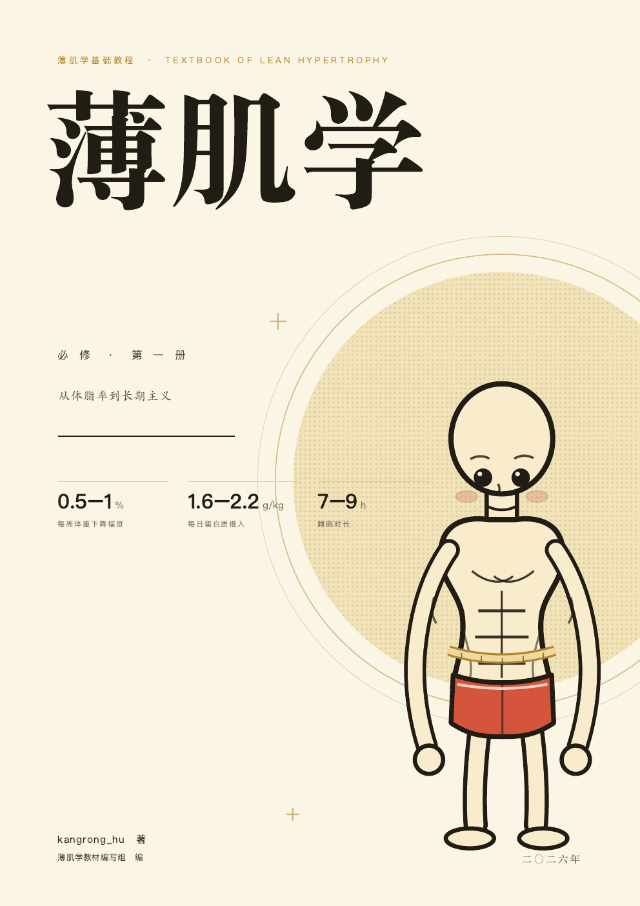
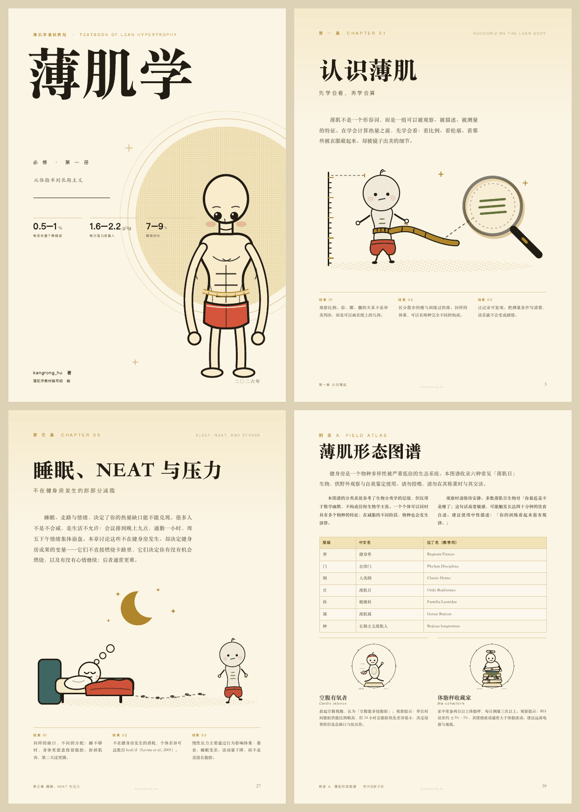

# 薄肌学 · 必修 第一册

> 一本教材式的减脂书：**权威的减脂科学 + 抽象插画 + 冷面幽默**。  
> 54 页 A4 · 6 章正文 · 薄肌形态图谱 · 参考答案 · 32 条参考文献

[](LICENSE)
[](LICENSE-CODE)
[](dist/薄肌学.pdf)
[](https://github.com/kangronghuuu/bojixue/actions/workflows/check.yml)



---

## 这是什么

《薄肌学》把「减脂」当成一门正经学科来写：有章节、有定义、有公式、有实验活动、有思考讨论、有参考答案，甚至有一份《薄肌形态图谱》。

- **权威的部分**：能量平衡、蛋白质 1.6–2.2 g/kg、训练容量与频率、NEAT、睡眠限制实验、平台期与 diet break……数字可查，文献可追溯（32 条，见附录 C）。
- **抽象的部分**：薄肌仔、测量卷尺、能量天平、六大「薄肌目」物种、RIR 体感温度计、平台期撞墙图……
- **有趣但有用**：每章末尾都有可以照着做的实验与练习，答案在书后。

> **下载**：[最新 Release](https://github.com/kangronghuuu/bojixue/releases/latest) · [`dist/薄肌学.pdf`](dist/薄肌学.pdf)（A4，54 页，约 10 MB）

## 内页预览



## 目录

- 绪言　薄肌学与研究的起点
- 第一章　认识薄肌：体脂率、FFMI、局部减脂、可复现测量
- 第二章　能量账本：CICO、TDEE 四栏、缺口与速度
- 第三章　三大营养素：蛋白质、碳水、脂肪、纤维与补剂
- 第四章　力量训练：渐进超负荷、容量、RIR、最小可行计划
- 第五章　睡眠、NEAT 与压力：被低估的变量
- 第六章　平台期与长期主义：diet break、聚餐、酒精与维持
- 附录 A　薄肌形态图谱（六种「薄肌目」物种）
- 附录 B　参考答案
- 附录 C　公式、速查表与 32 条参考文献
- 后记

## 科学性

书中所有数字都经过一轮独立事实核查，记录在：

- [`research/facts.md`](research/facts.md)：逐条核对表、算术核对、引用修正
- [`research/references.md`](research/references.md)：GB/T 7714 顺序编码制参考文献

重点引用了 Morton et al. (2018)、Helms et al. (2014)、Nedeltcheva et al. (2010)、Spiegel et al. (2004)、Levine et al. (2005)、Byrne et al. (2018, MATADOR)、WHO (2020)、中国居民膳食指南/DRIs (2022/2023)、GB 28050 等。

> 本书是科普与教学读物，**不构成医疗建议**。如有进食障碍史、代谢疾病或正在服药，请先咨询医生或注册营养师。

## 文件结构

```text
bojixue/
├── BOOK.json                # 页面清单
├── pages/                   # 每章一个 HTML 片段（可直接编辑）
├── css/book.css             # 整本书的排版系统
├── assets/art/              # 全部原创 SVG 插画
├── build/
│   ├── build.py             # 合并页面 → 注入插画/页脚/页码 → 生成 PDF
│   └── crop_openers.py      # 章首页插画透明边裁切工具（需要 Pillow）
├── research/                # 事实核查与参考文献
├── dist/薄肌学.pdf           # 成品
├── STYLEGUIDE.md            # 写作与组件规范
├── BLUEPRINT.md             # 章节蓝图与事实库
└── docs/                    # README 预览图
```

## 本地构建

需要 **Chrome / Chromium**、Python 3.9+、macOS 自带的宋体/苹方/楷体（或其他平台的思源宋体/黑体/楷体）。

```bash
# 生成 PDF（macOS 默认 Chrome 路径；其他平台用 CHROME_BIN 指定）
python3 build/build.py --out index.html --pdf "dist/薄肌学.pdf"

# 只做版式检查（每页是否溢出）
python3 build/build.py --out build/audit.html --audit
```

Linux 上可安装 `fonts-noto-cjk` 与 `fonts-arphic-ukai` 作为字体回退；Windows 建议安装思源宋体/黑体。

构建脚本用到 Pillow 的功能只有裁切章首页插画（可选）：

```bash
python3 -m pip install -r requirements.txt
```

## 参与贡献

欢迎修 typo、补文献、重画插画、做英文版/繁中版、补充章节。请先读 [`CONTRIBUTING.md`](CONTRIBUTING.md) 与 [`STYLEGUIDE.md`](STYLEGUIDE.md)。

简单流程：

1. Fork 本仓库，新建分支（`feat/xxx`、`fix/xxx`）
2. 修改 `pages/` 或 `assets/art/`（不要直接改 `dist/`）
3. 运行 `python3 build/build.py --out build/audit.html --audit`，确认 `AUDIT OK`
4. 提 PR，说明改了什么、依据是什么

## 许可

- **书稿内容**（文字、插画、PDF）：[CC BY-NC-SA 4.0](LICENSE) —— 署名、非商业、相同方式共享
- **构建脚本**（`build/`、`Makefile`）：[MIT](LICENSE-CODE)

## 作者

**kangrong_hu**（GitHub: [@kangronghuuu](https://github.com/kangronghuuu)）

本书由 DeepSeek Harness 辅助完成。编写：薄肌学教材编写组（空腹有氧幽灵、蛋白粉仙人、深蹲架守夜人、体脂秤受害者、外卖备注狂魔、最后一块鸡胸肉、秤上的哲学家）  
绘图：薄肌学美术组  
事实核查：DeepSeek Harness 研究组

---

如果这本书让你在体重秤前笑了一下，欢迎点个 Star ⭐
